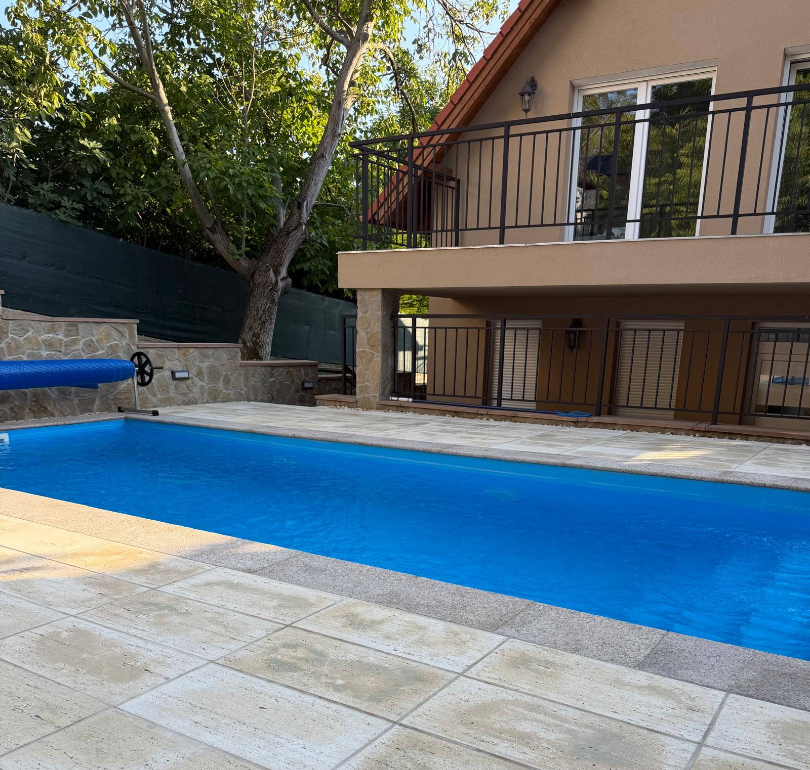

# Harmony Balaton Villa



Badacsonytomaj, Macaristan'da bulunan dört yatak odalı özel bir villa için
geliştirilen çok dilli tanıtım, rezervasyon ve içerik yönetim sistemi.

Villa tek oda, birden fazla oda veya dört odanın tamamı seçilerek kiralanabilir.
Ziyaretçiler oda bazında uygun tarihleri ve güncel fiyatı görüntüleyebilir, rezervasyon
talebi oluşturabilir ve banka havalesinden sonra ödeme dekontunu WhatsApp
üzerinden iletebilir.

## Özellikler

### Ziyaretçi sitesi

- İngilizce, Almanca, Macarca ve Türkçe dil desteği
- Mobil, tablet ve masaüstü uyumlu tasarım
- Villa, odalar, ortak alanlar ve çevre galerisi
- Tarih aralığı, yetişkin, çocuk ve evcil hayvan seçimi
- Canlı müsaitlik takvimi
- Hafta içi ve hafta sonuna göre otomatik fiyat hesaplama
- IBAN ile ödeme ve WhatsApp dekont yönlendirmesi
- Açık rezervasyon, iptal ve gizlilik politikaları
- Referans kodu ve e-posta ile güvenli rezervasyon durumu sorgulama
- Çok dilli blog ve SEO uyumlu yazı sayfaları
- Hakkımızda, galeri, blog ve iletişim sayfaları

### Yönetim paneli

- Mobil uyumlu yönetici arayüzü
- Rezervasyon ve ödeme durumu yönetimi
- Aylık hafta içi/hafta sonu fiyatlandırması
- Tüm villa ve her oda için ayrı fiyat, önceki ayı kopyalama ve toplu oran güncelleme
- Minimum konaklama süresi tanımlama
- Bakım veya özel kullanım için tarih kapatma
- Çok dilli blog yazısı oluşturma ve yayınlama
- İletişim formundan gelen destek taleplerini görüntüleme ve durum takibi
- Galeri görsellerini yükleme, sıralama ve kategorilendirme
- Hesap sahibi, hesap numarası, IBAN, BIC/SWIFT, e-posta, WhatsApp, kapasite ve evcil hayvan ücreti ayarları
- İptal, veri saklama ve yasal işletmeci ayarları

## Teknolojiler

- Next.js 16 ve React 19
- TypeScript
- Tailwind CSS 4
- Supabase Auth, PostgreSQL ve Storage
- Row Level Security (RLS)
- Vinext, Vite ve Cloudflare Workers uyumlu çalışma ortamı
- Radix UI, shadcn/ui ve Lucide Icons

## Sayfalar

| Adres | Açıklama |
| --- | --- |
| `/` | Ana sayfa ve rezervasyon takvimi |
| `/about` | Villa, bölge ve sık sorulan sorular |
| `/rooms` | Odalar ve galeri |
| `/blog` | Blog yazıları |
| `/blog/[slug]` | Blog yazısı detay sayfası |
| `/contact` | İletişim ve rezervasyon talep formu |
| `/reservation-status` | Referans ve e-posta ile rezervasyon durumu |
| `/privacy` | Gizlilik bildirimi |
| `/booking-terms` | Rezervasyon koşulları |
| `/cancellation-policy` | İptal ve iade politikası |
| `/admin/login` | Yönetici girişi |
| `/admin` | Yönetim paneli |

## Gereksinimler

- Node.js `22.13.0` veya üzeri
- npm
- Supabase projesi

## Yerel kurulum

Projeyi klonlayın ve bağımlılıkları yükleyin:

```bash
git clone https://github.com/frknnt/relaxvillapanzio.git
cd relaxvillapanzio
npm install
```

Ortam değişkeni dosyasını oluşturun:

```bash
cp .env.example .env.local
```

Windows PowerShell kullanıyorsanız:

```powershell
Copy-Item .env.example .env.local
```

`.env.local` içindeki değerleri Supabase projenize göre doldurun:

```env
NEXT_PUBLIC_SUPABASE_URL=https://your-project-ref.supabase.co
NEXT_PUBLIC_SUPABASE_PUBLISHABLE_KEY=sb_publishable_your_key
NEXT_PUBLIC_SITE_URL=https://alan-adiniz.example
```

Geliştirme sunucusunu başlatın:

```bash
npm run dev
```

Site varsayılan olarak [http://localhost:5173](http://localhost:5173)
adresinde açılır.

## Supabase kurulumu

Supabase Dashboard içindeki **SQL Editor** bölümünde aşağıdaki dosyaları sırayla
çalıştırın:

1. `supabase/relax_villa_schema.sql`
2. `supabase/advisor_fixes.sql`
3. `supabase/harden_public_column_access.sql`
4. `supabase/fix_reservation_expiry_ambiguity.sql`
5. `supabase/connect_blog_and_support.sql`
6. `supabase/add_payment_and_contact_fields.sql`
7. `supabase/security_hardening.sql`
8. `supabase/move_public_definers_to_private.sql`
9. `supabase/harden_support_rpc.sql`
10. `supabase/flexible_room_booking_and_turkish.sql`
11. `supabase/complete_room_pricing_workflow.sql`
12. `supabase/fix_room_availability_security.sql`
13. `supabase/private_property_and_turkish_blog.sql`
14. `supabase/professional_booking_trust_and_safety.sql`
15. `supabase/add_child_booking_fee.sql`
16. `supabase/fix_child_fee_total_constraint.sql`
17. `supabase/add_global_booking_rate_limit.sql`
18. `supabase/fix_booking_result_after_child_fee.sql`
19. `supabase/harmony_reference_prefix.sql`

Ana şema aşağıdaki kaynakları oluşturur:

- Yönetici kullanıcıları
- Rezervasyonlar ve rezervasyon işlem geçmişi
- Aylık fiyatlar
- Kapalı tarihler
- Rezervasyon ve banka ayarları
- Blog yazıları
- Galeri kayıtları
- `villa-media` Storage bucket'ı
- Müsaitlik, fiyatlandırma ve rezervasyon fonksiyonları
- RLS politikaları ve erişim yetkileri

### İlk yöneticiyi oluşturma

1. Supabase Dashboard'da **Authentication → Users** sayfasını açın.
2. **Add user → Create new user** ile yönetici hesabını oluşturun.
3. Oluşturulan kullanıcının `UID` değerini kopyalayın.
4. SQL Editor içinde aşağıdaki sorguyu UID değerini değiştirerek çalıştırın:

```sql
insert into public.admin_users (user_id, display_name, active)
values ('KULLANICI_UID', 'Villa Owner', true)
on conflict (user_id) do update
set display_name = excluded.display_name,
    active = true,
    updated_at = now()
returning user_id, display_name, active;
```

Yetkiyi doğrulamak için:

```sql
select au.email, admins.display_name, admins.active
from public.admin_users admins
join auth.users au on au.id = admins.user_id;
```

Daha ayrıntılı yönetici kurulum rehberi için
[ADMIN_SETUP.md](./ADMIN_SETUP.md) dosyasına bakın.

## Rezervasyon akışı

1. Yönetici ilgili ay için tüm villa ve dört odanın hafta içi/hafta sonu fiyatlarını tanımlar.
2. Misafir oda veya odaları, müsait tarihleri, kişi sayısını ve varsa evcil hayvan sayısını seçer.
3. Sistem toplam tutarı ve minimum gece kuralını otomatik hesaplar.
4. Rezervasyon `Ödeme bekleniyor` durumunda oluşturulur ve tarihler geçici olarak kapanır.
5. Misafir ödemeyi IBAN'a gönderir ve dekontu WhatsApp üzerinden iletir.
6. Yönetici ödemeyi kontrol ederek rezervasyonu panelden onaylar.
7. Süresi içinde ödeme alınmayan talepler otomatik olarak zaman aşımına uğrar.

Fiyat girilmemiş aylar rezervasyona kapalıdır. Bu davranış, eksik veya yanlış
fiyatla rezervasyon oluşturulmasını önler.

## Komutlar

| Komut | Açıklama |
| --- | --- |
| `npm run dev` | Yerel geliştirme sunucusunu başlatır |
| `npm run build` | Üretim derlemesini oluşturur |
| `npm run start` | Üretim derlemesini yerel olarak çalıştırır |
| `npm run lint` | ESLint kontrollerini çalıştırır |
| `npm test` | Fiyatlandırma ve oda müsaitliği birim testlerini çalıştırır |
| `npm run install:ci` | Kilit dosyasına göre CI bağımlılık kurulumu yapar |

## Proje yapısı

```text
app/
  admin/              Yönetici paneli sayfaları
  blog/               Blog liste ve detay sayfaları
  about/              Hakkımızda sayfası
  contact/            İletişim sayfası
  rooms/              Oda ve galeri sayfası
components/
  admin/              Yönetim paneli bileşenleri
  booking/            Takvim ve rezervasyon bileşenleri
  site/               Ortak ziyaretçi sitesi bileşenleri
lib/
  booking/            Fiyatlandırma yardımcıları
  supabase/           Supabase istemcileri ve tipleri
public/images/        Statik villa görselleri
supabase/             Veritabanı şeması ve güvenlik SQL dosyaları
```

## Güvenlik

- Veritabanı tablolarında Row Level Security aktiftir.
- Yönetim işlemleri yalnızca aktif `admin_users` kayıtlarına açıktır.
- Misafirlerin kişisel ve rezervasyon bilgileri anonim sorgulara kapalıdır.
- Ziyaretçiler destek talebini yalnızca doğrulamalı RPC üzerinden oluşturabilir; tabloya doğrudan anonim yazma kapalıdır.
- İletişim ve rezervasyon formlarında veritabanı seviyesinde alan doğrulaması, istek sınırı ve sunucu taraflı bot tuzağı bulunur.
- Sahte taleplerle takvimin kilitlenmesini önlemek için e-postadan bağımsız genel sınırlar vardır: saatte en fazla 10 yeni talep, aynı telefon numarasından saatte en fazla 3 talep ve aynı anda en fazla 15 ödenmemiş bekleyen talep. Sınırlar `supabase/add_global_booking_rate_limit.sql` dosyasının başından değiştirilebilir.
- Rezervasyon tarih aralığı, maksimum konaklama, kişi sayısı ve fiyat taşması sunucu tarafında yeniden doğrulanır.
- Güvenlik başlıkları CSP, HSTS, clickjacking, MIME-sniffing ve gereksiz tarayıcı izinlerini sınırlar.
- Yönetim paneli yanıtları tarayıcı ve ara sunucu önbelleğine alınmaz.
- Tarayıcıda yalnızca Supabase publishable key kullanılır.
- `service_role` veya secret key istemci koduna eklenmemelidir.
- `.env.local` Git tarafından yok sayılır ve repoya gönderilmemelidir.
- Canlıya almadan önce Supabase Dashboard içinde **Authentication → Attack Protection**
  bölümünden leaked password protection özelliği etkinleştirilmelidir.
- IBAN ödemesi uygulama tarafından tahsil edilmez; yönetici yalnızca banka
  hesabında gördüğü ödemeyi panel üzerinden onaylar.

## Üretime alma

Hosting servisinde aşağıdaki ortam değişkenlerini tanımlayın:

```text
NEXT_PUBLIC_SUPABASE_URL
NEXT_PUBLIC_SUPABASE_PUBLISHABLE_KEY
NEXT_PUBLIC_SITE_URL
```

Ardından üretim derlemesini doğrulayın:

```bash
npm run build
```

> Gizli anahtarları, yönetici şifrelerini, IBAN bilgisini veya gerçek müşteri
> verilerini GitHub deposuna eklemeyin.

## Lisans

Bu proje Harmony Balaton Villa için özel olarak geliştirilmiştir. Kaynak kodun
kullanımı ve dağıtımı proje sahibinin iznine tabidir.
